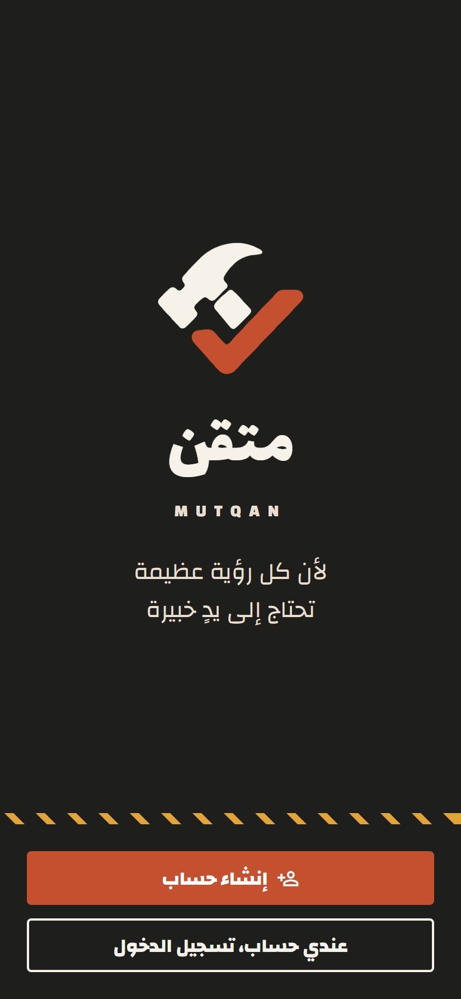
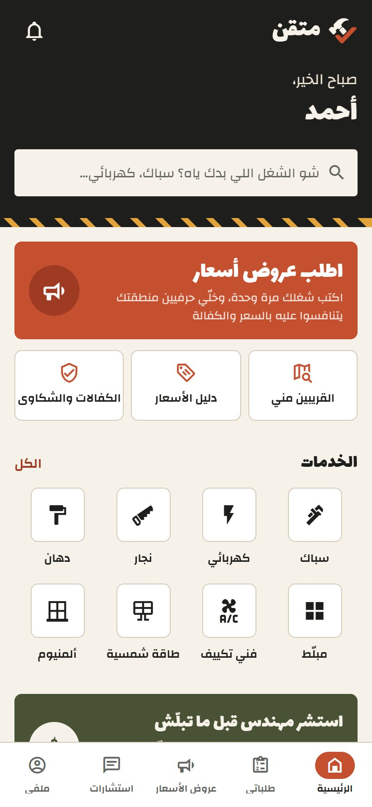
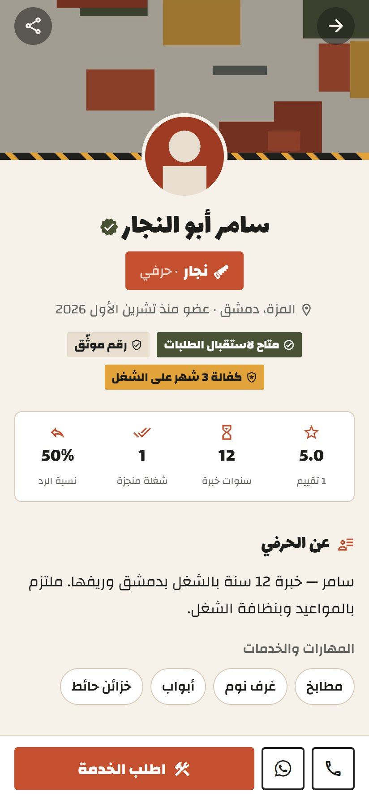
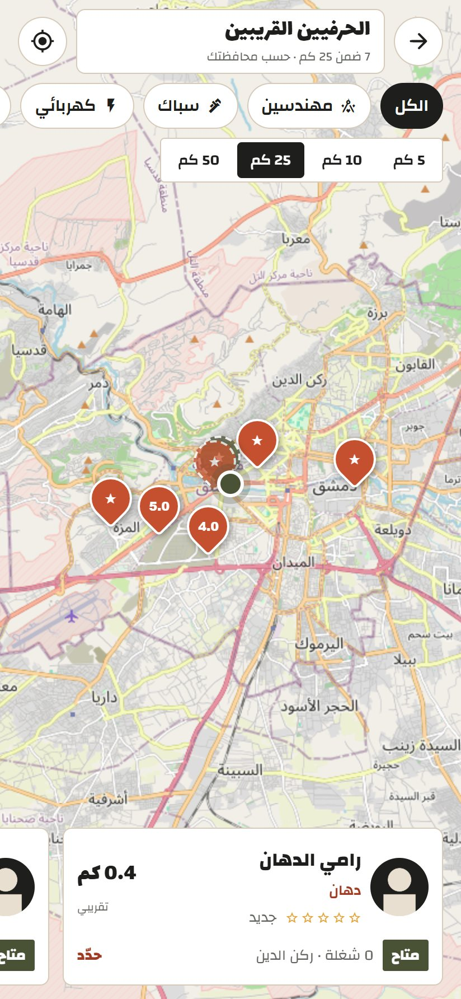

# 🛠️ Motqan (متقن) — Full-Stack Mobile Application Showcase

  
  
  
  
  

---

## 📌 About The Project
**Motqan (متقن)** is a cross-platform mobile application designed to seamlessly connect clients with skilled local craftsmen, contractors, and engineering consultants in Syria.

It streamlines service discovery, hiring, and real-time interaction while offering an administrative dashboard for system verification and service moderation.

---

## 🌐 Architecture & Live Infrastructure
The complete application ecosystem is deployed live and running in production:

- **Frontend:** Built with **React Native (Expo SDK)**, compiled to Native Android APK using **EAS Build**.
- **Backend API:** Scalable **Node.js & Express** RESTful API hosted live on **Pxxl Cloud Services**.
  - **Live Base Endpoint:** `https://motqan-backend.pxxlspace.cv/api`
- **Database:** Distributed Cloud Database hosted on **TiDB Cloud (MySQL-compatible)** managing authenticated users, services, and system roles.
- **Security:** Complete **JWT Authorization** with encrypted password hashing.

---

## 📱 Mobile App Download (Demo Preview)
You can download and test the live compiled Android APK directly:

📥 **[Download Latest Android APK (Preview Release)](https://expo.dev/accounts/hamzaeng/projects/mutqan/builds/91983dd5-790f-48ba-a2ba-817ce388be0c)**

---

## 🎨 Application UI Showcase

Below are actual UI screens from the **Motqan (متقن)** mobile application:

| Splash & Branding | Welcome Screen | Main Home & Marketplace |
| :---: | :---: | :---: |
|  |  |  |

| Service Provider Details | Interactive Location Map | Job Request Creation |
| :---: | :---: | :---: |
|  |  |  |

---

## 👨‍💻 Developer & Author
**Eng. Hamza Salameh**  
*Full-Stack & Mobile Developer | Assistant IT Engineer*  
- **GitHub:** [@Eng-hamza-salameh](https://github.com/Eng-hamza-salameh)
- **Status:** Complete Application Deployed & Verified.
